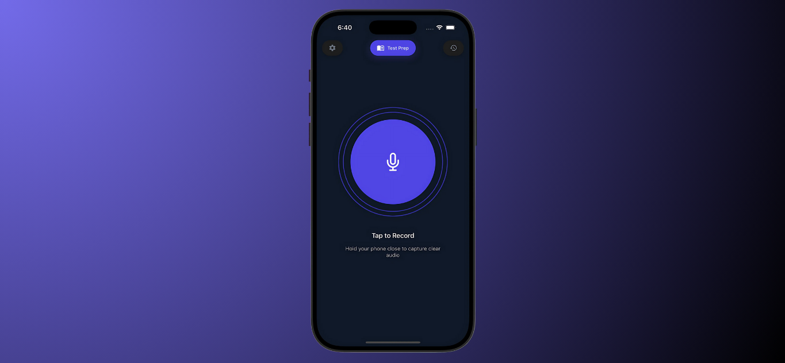
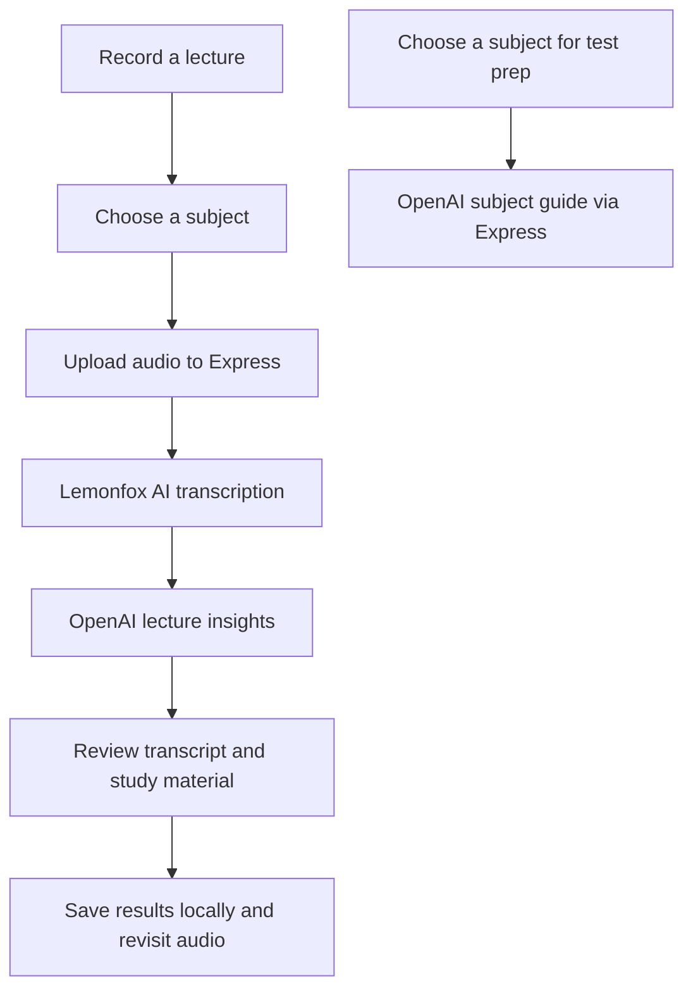

# Clarify

**Turn lecture recordings into structured study material.**

Clarify is a mobile study companion that helps students revisit what they hear in class. Record a lecture, assign it to a subject, and generate a transcript with summaries, key points, practice questions, and a study plan. Save sessions for later review or request a separate test preparation guide for a subject.



## Features

- **Lecture recording:** capture microphone audio directly in the mobile app.
- **AI transcription:** convert recordings into text through Lemonfox AI.
- **Structured insights:** generate summaries, key points, potential test questions, a glossary, lecture structure, action items, and a study plan through OpenAI.
- **Audio playback:** replay recordings and seek through audio while reviewing results.
- **Subject organization:** add subjects and browse saved recordings grouped by class.
- **Local history:** save results, reopen previous sessions, and delete history entries.
- **Test preparation:** generate key concepts, formulas, study strategies, and common questions for a selected subject.

Generated sections appear when included in the model response. Test preparation uses the subject and academic level; it does not use saved lecture transcripts.

## How it works



The backend temporarily stores uploads in `uploads/`. The transcription controller attempts to delete the uploaded file after processing, whether processing succeeds or fails.

## Technology

| Layer | Implementation |
| --- | --- |
| Mobile app | React Native 0.76, React 18, TypeScript |
| Runtime | Expo SDK 52 |
| Styling | NativeWind and Tailwind CSS |
| Navigation | React Navigation |
| Audio | Expo AV |
| Device storage | AsyncStorage |
| Backend | Node.js, Express 5, TypeScript |
| Upload handling | Multer, with a 25 MiB file limit |
| Transcription | Lemonfox AI |
| Study generation | OpenAI Chat Completions, currently configured for `gpt-3.5-turbo` |

MongoDB is not required by the current application flow. Mongoose is listed as a dependency, but saved session data currently lives on the device.

## Using Clarify

1. Open the app and grant microphone permission.
2. Tap the microphone to record, then tap again to stop.
3. Select or add the subject associated with the recording.
4. Wait for transcription and insight generation.
5. Review the summary, transcript, and generated study sections, and replay the audio.
6. Save the session from the results screen to revisit it in recording history.
7. Open Test Prep and choose a subject for a separate preparation guide.

## Project structure

```text
Clarify/
|-- client/
|   |-- App.tsx
|   |-- components/       # Settings and subject selection
|   |-- navigation/       # Screen routes and navigation types
|   |-- screens/          # Recording, processing, results, history, test prep
|   |-- services/         # API configuration and service scaffolding
|   `-- assets/
|-- server/
|   |-- app.ts            # Express app and health route
|   |-- config/           # Environment configuration
|   |-- routes/           # Upload and test-prep routes
|   |-- controllers/      # Request processing
|   |-- services/         # Lemonfox and OpenAI integrations
|   `-- utils/            # File cleanup and logging
|-- docs/images/          # README screenshot
|-- scripts/              # Local startup helper
|-- start-clarify.cmd
`-- LICENSE
```

## Data and current limitations

- Sessions and settings use device-local AsyncStorage. There is no account system or cloud synchronization.
- Saved audio is referenced by local URI. Long-term retention depends on the app and device storage lifecycle.
- Audio is sent to the backend and Lemonfox AI; transcript text is sent to OpenAI. Processing requires network access and valid credentials and may incur provider charges.
- Transcription currently specifies English.
- AI responses must match the expected JSON structure. Missing sections, parsing failures, and inaccurate content are possible. Check important details against the lecture.
- Lecture insight generation currently has an 800-token output cap, limiting detail across the requested sections.
- The backend has no authentication or rate limiting. Add these before exposing it as a public service.
- Full-text search, cloud backup, and note export are not implemented in the current code.